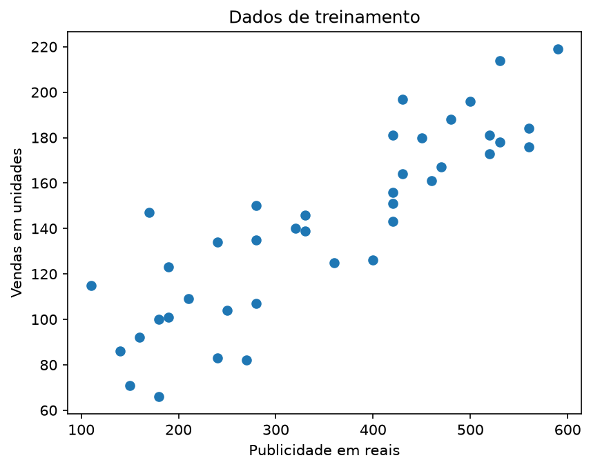
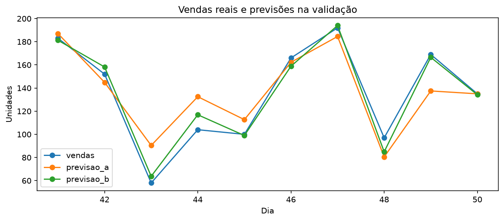

<div align="center">

# 📊 Comparação de Modelos de Regressão Linear

### Previsão de vendas com publicidade e descontos

[](https://www.python.org/)
[](https://pandas.pydata.org/)
[](https://matplotlib.org/)
[](https://scikit-learn.org/)

**Um projeto didático de Machine Learning para treinar, comparar e avaliar modelos de regressão linear.**

</div>

---

## 🎯 Sobre o projeto

Este experimento investiga se incluir o **percentual de desconto**, além do investimento em publicidade, ajuda a prever a quantidade de vendas de uma loja.

Dois modelos são treinados com os mesmos dados e comparados pelo **Erro Absoluto Médio (MAE)**:

| Modelo | Variáveis de entrada |
|:--|:--|
| **A** | Investimento em publicidade |
| **B** | Investimento em publicidade e percentual de desconto |

A escolha é feita com os dados de validação; em seguida, o modelo selecionado é avaliado no conjunto de teste.

## 🧰 Tecnologias

- **Python** — linguagem do projeto.
- **Pandas** — leitura e manipulação dos dados.
- **Matplotlib** — criação dos gráficos.
- **Scikit-learn** — treinamento da regressão linear e cálculo do MAE.

## 📁 Estrutura do projeto

```text
.
├── Exercicio.py
├── vendas_loja.csv
├── requirements.txt
├── README.MD
└── resultados/
    ├── 01_dados_treino.png
    ├── 02_comparacao_validacao.png
    ├── comparacao_validacao.csv
    └── resultado_teste.csv
```

Os arquivos dentro de `resultados/` são criados pelo programa quando ele é executado.

## 🚀 Como executar

### Pré-requisitos

- Python instalado;
- terminal aberto na pasta do projeto;
- acesso à internet para instalar as dependências.

### Instale as dependências

```bash
python -m pip install -r requirements.txt
```

### Execute o experimento

Com exibição das janelas dos gráficos:

```bash
python Exercicio.py
```

Sem abrir janelas (por exemplo, em ambientes sem interface gráfica):

```bash
python Exercicio.py --sem-janelas
```

Os gráficos e arquivos CSV são salvos automaticamente em `resultados/`.

## 🗃️ Dados utilizados

O arquivo `vendas_loja.csv` contém **60 registros simulados** para fins didáticos:

| Coluna | Descrição |
|:--|:--|
| `dia` | Identificador do período, de 1 a 60. |
| `publicidade` | Investimento em publicidade, em reais. |
| `desconto` | Percentual de desconto aplicado. |
| `vendas` | Quantidade de unidades vendidas (alvo da previsão). |

A divisão dos dados é fixa: **40 registros para treino**, **10 para validação** e **10 para teste**.

## 📈 Resultados

Na validação, o Modelo B foi selecionado por apresentar menor MAE:

| Métrica | Modelo A | Modelo B |
|:--|--:|--:|
| MAE na validação | 14,40 | **5,22** |
| Selecionado | Não | **Sim** |

O Modelo B obteve MAE de aproximadamente **6,23 unidades** no conjunto de teste. Para um cenário com publicidade de **R$ 300,00** e desconto de **10%**, a previsão foi de aproximadamente **129,71 unidades**.

### Visualizações

**Dados de treinamento** — relação entre investimento em publicidade e vendas nos registros de treino.



**Comparação na validação** — vendas reais e previsões dos dois modelos.



## 📦 Arquivos gerados

| Arquivo | Conteúdo |
|:--|:--|
| `01_dados_treino.png` | Gráfico dos dados usados no treinamento. |
| `02_comparacao_validacao.png` | Gráfico de vendas reais e previsões na validação. |
| `comparacao_validacao.csv` | Previsões e erros dos modelos na validação. |
| `resultado_teste.csv` | Previsões do modelo escolhido no conjunto de teste. |

## ⚠️ Limitações

- A base é simulada e pequena (60 registros).
- A divisão entre treino, validação e teste é fixa.
- O experimento considera apenas modelos de regressão linear.
- A melhora observada não comprova uma relação causal entre descontos e aumento das vendas; os resultados não garantem desempenho em cenários reais.

O foco é demonstrar o fluxo de preparação dos dados, treinamento, comparação e avaliação de modelos preditivos.

## 👤 Autor

**Gabriel Rodrigues Alves**

- GitHub: [@GabrielAlves106](https://github.com/GabrielAlves106)
- LinkedIn: [Gabriel Alves](https://www.linkedin.com/in/gabriel-alves111)
